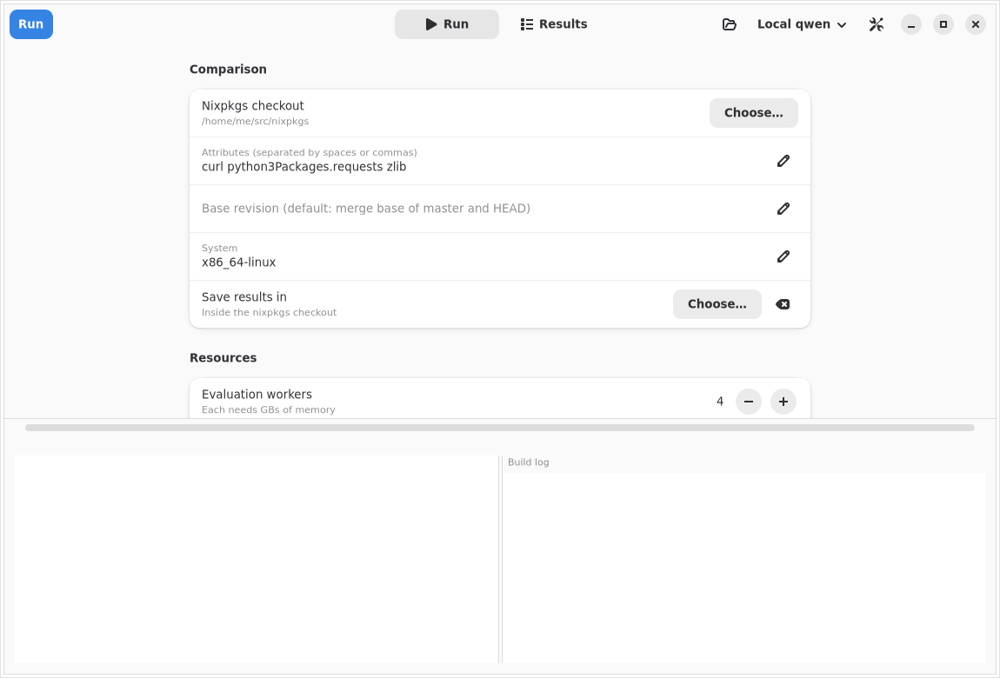
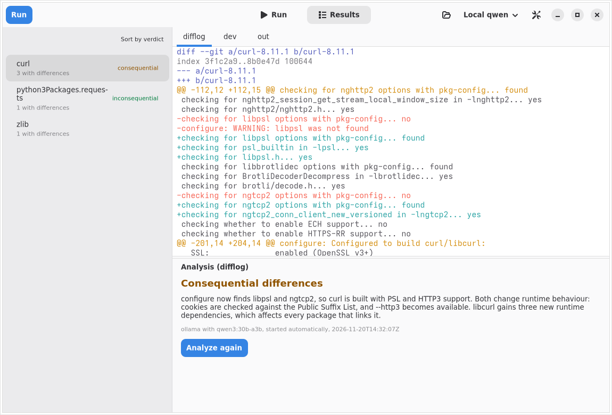

Here are tools which I use to review nixpkgs packages, mainly to diff package outputs and logs.

## Programs

- `nix-utility-gui`: GUI combining `diff-nixpkgs-attr`, `difflog`, `diffoscope-nix`, `nix-log-diff-analyzer`.
- `diff-nixpkgs-attr`: builds nixpkgs attributes at the current and base
  revisions, then compares changed outputs and build logs with `difflog` and
  `diffoscope-nix`. The differences are also saved as plain text in
  `$PWD/differences-ATTRS-BRANCH-SHORTREV/`.
- `difflog`: normalizes two Nix build logs before diffing them to hide common
  nondeterministic differences.
- `diffoscope-nix`: runs diffoscope on two Nix store
  paths after masking irrelevant embedded store hashes and build IDs.
- `nix-log-diff-analyzer` (experimental): uses an LLM (local ollama or
  llama.cpp, or an OpenAI-compatible remote such as Gemini) with the model named
  by `NIX_LOG_DIFF_ANALYZER_MODEL` to classify a build-log diff as
  consequential or environmental noise. Do not fully trust its result; a human
  should always at least skim the output.

## Screenshots

<picture>
  <source media="(prefers-color-scheme: dark)" srcset="https://raw.githubusercontent.com/Artturin/nix-utility-tools/screenshots/run-dark.png">
  
</picture>

<picture>
  <source media="(prefers-color-scheme: dark)" srcset="https://raw.githubusercontent.com/Artturin/nix-utility-tools/screenshots/results-dark.png">
  
</picture>

## Examples

Compare selected packages in the working tree against their merge-base with
`master`:

```sh
diff-nixpkgs-attr qt6Packages.qtbase kdePackages.dolphin
```

Browse the differences it saved in the GUI:

```sh
nix-utility-gui ./differences-qt6Packages.qtbase+kdePackages.dolphin-my-branch-1a2b3c4
```

Compare the normalized build logs for two build results:

```sh
difflog ./result ./result1
```

Compare two build results with diffoscope while ignoring embedded store hashes:

```sh
diffoscope-nix ./result ./result1
```

Classify a sorted and deduplicated build-log diff with an LLM (ollama by default):

```sh
difflog --sort-lines ./result ./result1 | uniq | NIX_LOG_DIFF_ANALYZER_MODEL=qwen nix-log-diff-analyzer
```
